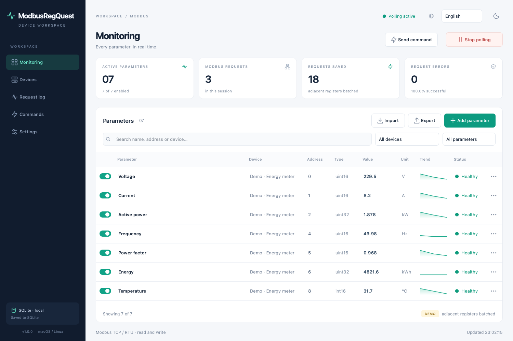
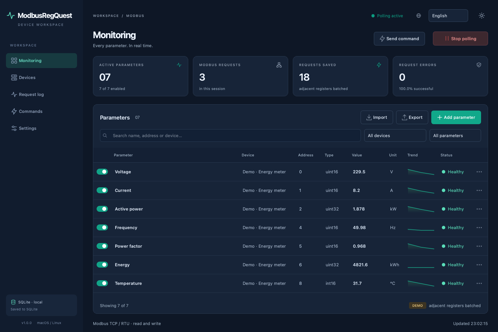
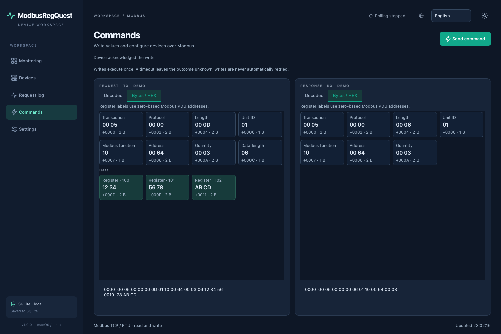
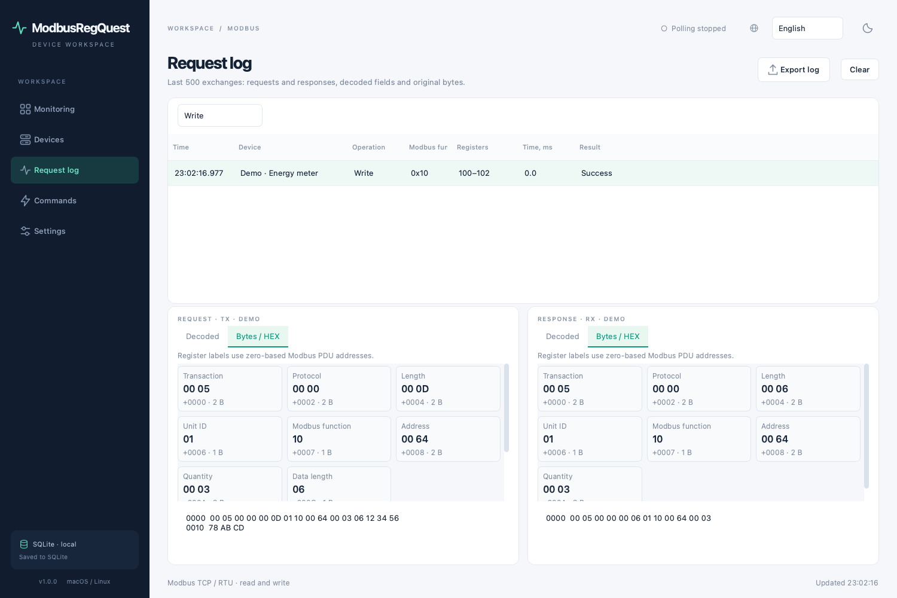

**English** | [Русский](README.ru.md)

<div align="center">


# ModbusRegQuest

**A desktop application for polling, configuring, and controlling Modbus devices on macOS and Linux.**

Configure your registers once — monitor all parameter values in a single table.

Modbus TCP / RTU · Read and write · Light / dark theme · Apache 2.0

</div>

<!-- toc:start -->

## Contents

- [Features](#features)
- [Installation](#installation)
  - [macOS](#macos)
  - [Ubuntu / Debian](#ubuntu--debian)
- [Quick start](#quick-start)
  - [Writing values and sending commands](#writing-values-and-sending-commands)
  - [Request and response log](#request-and-response-log)
  - [Example parameters](#example-parameters)
  - [Addressing: 0 or 1](#addressing-0-or-1)
  - [Scaling](#scaling)
  - [Data types and byte order](#data-types-and-byte-order)
  - [How requests are merged](#how-requests-are-merged)
  - [Statuses and errors](#statuses-and-errors)
- [Configuration and language](#configuration-and-language)
- [Running from source](#running-from-source)
  - [Local TCP simulator](#local-tcp-simulator)
- [Building installers](#building-installers)
  - [Releases with GitHub Actions](#releases-with-github-actions)
  - [macOS signing and notarization](#macos-signing-and-notarization)
- [Checks](#checks)
  - [README table of contents](#readme-table-of-contents)
- [Troubleshooting](#troubleshooting)
- [Project structure](#project-structure)
- [Feedback](#feedback)
- [License](#license)

<!-- toc:end -->



<details>
<summary>Dark theme, commands, and communication log</summary>







</details>

## Features

- **One table for all devices.** Name, device, address, type, current value, unit, sparkline, and parameter status. Search and filter by device, activity, and errors.
- **Writes and commands.** FC05/06/0F/10 and Mask Write FC16 (codes in HEX): switch outputs, write single or multiple registers, and change a selected bit. Writing a parameter value uses its configured type, scale, and byte order.
- **Modbus TCP and RTU.** Read Holding Registers, Input Registers, Coils, and Discrete Inputs using FC03, FC04, FC01, and FC02. Multiple devices in one configuration, including multiple Unit IDs on the same RTU port.
- **Flexible data types.** Signed and unsigned 16/32/64-bit integers, Float32/Float64, and booleans. Parameters can span 1, 2, or 4 registers. For a boolean in a register, select a bit from 0 to 15.
- **Scaling and byte order.** Decimal scaling, byte and word swapping, and zero-based or one-based addressing.
- **Configurable polling.** A separate interval for each parameter, from 0.1 seconds to 24 hours, global start/stop, and individual parameter switches. Communication runs in a worker thread.
- **Fewer requests.** Adjacent and overlapping ranges are merged automatically. Statistics show request and error counts, as well as requests saved by merging.
- **Local storage.** Devices, parameters, language, and theme are saved to SQLite after every change. Import and export configurations as JSON.
- **Communication log.** The last 500 request/response pairs, including reads, writes, errors, and incomplete responses. Decoded data, raw bytes, frame field labels, and the address of each two-byte register. Export the log as JSON.
- **Light and dark themes.** Switch from the top bar, save your preference, and transfer the theme with your configuration.
- **Demo mode.** An integrated simulator lets you explore the interface without hardware.

## Installation

Prebuilt packages include Python and Qt; no separate Python installation is required.

| System | Processor | Release file |
| --- | --- | --- |
| macOS | Apple Silicon · ARM64 | [ModbusRegQuest-1.0-macos-arm64.dmg](https://github.com/apayvin11/modbus-reg-quest/releases/download/v1.0.0/ModbusRegQuest-1.0-macos-arm64.dmg) |
| macOS | Intel · x86_64 | [ModbusRegQuest-1.0-macos-x86_64.dmg](https://github.com/apayvin11/modbus-reg-quest/releases/download/v1.0.0/ModbusRegQuest-1.0-macos-x86_64.dmg) |
| Ubuntu / Debian | Intel / AMD · x86_64 | [modbusregquest_1.0_amd64.deb](https://github.com/apayvin11/modbus-reg-quest/releases/download/v1.0.0/modbusregquest_1.0_amd64.deb) |
| Ubuntu / Debian | ARM64 | [modbusregquest_1.0_arm64.deb](https://github.com/apayvin11/modbus-reg-quest/releases/download/v1.0.0/modbusregquest_1.0_arm64.deb) |

Download the appropriate file from [release v1.0.0](https://github.com/apayvin11/modbus-reg-quest/releases/tag/v1.0.0). Checksums for all four installers are available in [SHA256SUMS](https://github.com/apayvin11/modbus-reg-quest/releases/download/v1.0.0/SHA256SUMS). You can also build the packages yourself using the instructions below.

### macOS

Requires **macOS 15 Sequoia or later**.

1. Open the appropriate `.dmg`.
2. Drag **ModbusRegQuest.app** onto the **Applications** shortcut inside the disk image.
3. Eject the image. Launch ModbusRegQuest from Applications, Launchpad, or Spotlight. You can pin its icon to the Dock.

By default, builds use a local ad-hoc signature without Apple notarization. When you first launch a downloaded application, macOS may require you to allow it in **System Settings → Privacy & Security**. Developer ID signing and notarization are described in the release section.

### Ubuntu / Debian

Release packages require **Ubuntu 24.04+ or Debian 13+**, an X11 desktop or Wayland with XWayland, and `glibc ≥ 2.39`.

Open the `.deb` in your system's package installer or install it using APT:

```bash
# Intel / AMD
sudo apt install ./modbusregquest_1.0_amd64.deb

# ARM64 — use this instead of the command above
sudo apt install ./modbusregquest_1.0_arm64.deb
```

APT installs the required system libraries. After installation, find **ModbusRegQuest** in the applications menu. You can also run `modbusregquest` in a terminal.

To uninstall:

```bash
sudo apt remove modbusregquest
```

Uninstalling the package preserves your configuration.

## Quick start

1. Open **Devices → Add device**.
2. For **TCP**, enter the IP address/hostname, port, Unit ID, and timeout. For **RTU**, select the serial port, baud rate, parity, and stop bits.
3. Select zero-based or one-based addressing.
4. On the **Monitoring** page, click **Add parameter**. Enter the name, device, read function, address, data type, unit, and polling interval.
5. Adjust scaling and byte order if needed. Save the parameter.
6. Click **Start polling**. Values, statuses, and sparklines appear in the table.

All settings are saved automatically. On a normal application launch, polling is **always off**. Press **Space** to start or stop polling; **⌘N / Ctrl+N** opens the parameter creation dialog. Double-click a row to edit it.

In an empty workspace, **Open demo mode** creates a test device and starts polling. The interface labels the demo explicitly; its values are generated by the application.

### Writing values and sending commands

To write a configured parameter's value, open **⋯ → Write value**. Enter the value in the same units shown in the table. The application reverses the scaling and applies the configured byte order. For example, entering `23.4` for a `uint16` with scale `n = 1` writes the raw number `234`.

FC04 input registers and FC02 discrete inputs are read-only. For a `bool` in a Holding Register, Mask Write Register changes the selected bit while preserving all other bits.

For an arbitrary write, open **Commands → Send command**:

1. Select the device and write function.
2. Enter the address according to the device's 0/1 addressing setting.
3. Enter integers separated by spaces. Decimal and `0x` HEX notation are supported: `123 456` or `0x007B 0x01C8`.
4. Review the PDU preview, address range, and data.
5. Click **Send command**. The commands page shows an acknowledgment or error, together with the full request and response.

| Function (HEX) | Operation | Values |
| --- | --- | --- |
| `05` | Write Single Coil | One value: `0` or `1` |
| `06` | Write Single Register | One integer `0…65535` |
| `0F` | Write Multiple Coils | 1 to 1968 values of `0` / `1` |
| `10` | Write Multiple Registers | 1 to 123 integers `0…65535` |
| `16` | Mask Write Register | Two 16-bit masks: AND and OR |

Commands execute **once** and are available while polling is stopped. Reads and writes share one worker thread, so requests do not interleave on an RTU line. After an acknowledged write, active polling refreshes values on the next read. Writes are never retried automatically: a timeout or lost response means the outcome is unknown; the device may already have executed the command.

Commands such as “Start”, “Stop”, and “Reset”, as well as device settings, are sent by writing to registers specified in the device documentation. There is no universal command address shared by all Modbus devices.

### Request and response log

Open **Request log** and select a row. Two panels show **Request · TX** and **Response · RX**. The selection is preserved as new entries arrive.

- **Decoded view:** transport, Unit ID, function, address, quantity, register/bit values, write acknowledgment, or exception code. For polled parameters, decoded values, types, and units are also shown.
- **Bytes / HEX:** each group of bytes has a label. For TCP, transaction, protocol, length, Unit ID, and PDU are highlighted. For RTU, Unit ID, PDU, and CRC16 are highlighted. The data byte count field has a separate “Data length” label.
- Register data is grouped **in pairs of bytes**, with the **zero-based register address in the PDU** above each pair. For example, a response reading addresses 100–101 shows `Register · 100: 12 34` and `Register · 101: 56 78`.
- A plain HEX dump with offsets is available at the bottom for copying. If a frame was not fully sent, the prepared request is shown separately; the decoded view reports the number of bytes actually sent.
- Incomplete, erroneous, and CRC-corrupted responses are preserved as received. Demo frames are labeled as simulated.
- Filter reads, writes, and failed exchanges. **Export log** saves all current entries as JSON, including TX/RX, HEX bytes, timestamps, addresses, and errors.

The log is stored in memory and holds up to 500 exchanges. It is excluded from configuration exports and cleared when the application exits.

### Example parameters

Suppose a device provides the following Holding Registers with zero-based addressing:

| Name | Address | Type | Registers | Scale `n` | Unit | Raw → result |
| --- | ---: | --- | ---: | ---: | --- | --- |
| Voltage | 0 | `uint16` | 1 | 1 | V | `2304 → 230.4` |
| Current | 1 | `uint16` | 1 | 2 | A | `842 → 8.42` |
| Active power | 2 | `uint32` | 2 | 3 | kW | `1938 → 1.938` |
| Frequency | 4 | `uint16` | 1 | 2 | Hz | `5000 → 50` |
| Temperature | 8 | `int16` | 1 | 1 | °C | `−125 → −12.5` |

If the parameters share an interval and are due at the same time, addresses 0–4 are read in a single request for 5 registers. The parameter at address 8 is read separately.

### Addressing: 0 or 1

The addressing switch is set **per device** and applies to all its parameters.

| Mode | Entered address | Address in the Modbus request |
| --- | ---: | ---: |
| Offset disabled | 0 | 0 |
| Offset enabled | 1 | 0 |
| Offset enabled | 101 | 100 |

Enter the register number **without the `3xxxx` / `4xxxx` area prefix**. The read function selects the area. For example, if the documentation labels the first Holding Register as `40001`, you would usually select FC03, address `1`, and one-based addressing. Always check the specific device's register map.

### Scaling

The “Decimal places” field sets the power of ten:

```text
Value = decoded number × 10^(−n)

n =  0: 2345 → 2345
n =  1: 2345 → 234.5
n =  2: 2345 → 23.45
n = −1: 2345 → 23450
```

The supported range is −9 to 9. Scaling is applied after decoding the number. It does not apply to `bool`.

### Data types and byte order

| Type | Registers | Description |
| --- | ---: | --- |
| `uint16` / `int16` | 1 | Unsigned / signed 16-bit integer |
| `uint32` / `int32` | 2 | Unsigned / signed 32-bit integer |
| `float32` | 2 | IEEE 754, single precision |
| `uint64` / `int64` | 4 | Unsigned / signed 64-bit integer |
| `float64` | 4 | IEEE 754, double precision |
| `bool` | 1 | Selected register bit; for FC01/02, one discrete address |

For 32-bit values, **ABCD**, **BADC**, **CDAB**, and **DCBA** are available. For 64-bit values, the same modes mean: original order, byte swapping within each word, reversal of all 16-bit words, and complete byte reversal. Choose the mode specified in your device documentation. `NaN` and `Infinity` are reported as decoding errors.

### How requests are merged

The scheduler considers enabled parameters that are due for a read. Merging is possible when they belong to **the same device and Modbus function**, and their ranges are adjacent or overlapping.

- Up to **125 registers** per request for FC03/04.
- Up to **2000 discrete addresses** per request for FC01/02.
- A parameter spanning 2 or 4 registers is never split between requests.
- Gaps containing unconfigured addresses are not read, helping avoid unsupported registers.
- Parameters with different intervals are merged when due at the same time. Cycles missed during a slow response do not accumulate.

Polling runs sequentially in a single worker thread. A very short interval does not guarantee an equally fast update rate: timeouts, serial line speed, and the number of requests all affect it.

### Statuses and errors

**OK** indicates a recent successful read. **Waiting** means no value has been received yet; **Paused** means polling is stopped; **Disabled** means the parameter is excluded from polling. **Stale** appears after an extended period without updates.

On a communication error, the last successful value remains visible, but the row changes to **Error**; error details are available in the tooltip and log. Polling resumes automatically after the connection is restored. Counters apply to the current polling session; sparklines keep the last 60 successful values in memory.

## Configuration and language

Select the language in the upper-right corner. The sun/moon button switches the theme. Language and theme are saved in SQLite and included in JSON exports.

SQLite is stored in the application's user data directory. The exact path is shown in **Settings → Local database**. Typical locations are:

- macOS: `~/Library/Application Support/ModbusRegQuest/ModbusRegQuest/configuration.db`;
- Linux: `~/.local/share/ModbusRegQuest/ModbusRegQuest/configuration.db`.

Use **Export** and **Import** to transfer configurations. JSON includes devices, parameters, identifiers, language, and theme; it uses the `modbusregquest` format with schema version `1` and is human-readable. Import validates types, ranges, relationships, and identifier uniqueness; the maximum file size is 5 MiB. After confirmation, the entire current configuration is replaced. Export it first if you need to restore it later.

Configuration writes use SQLite transactions; exports use a temporary file followed by an atomic replacement. The communication log and value history are not saved to the database.

On the first launch under the new application name, an existing ModbusPoll database is copied to the new user directory. The original database is preserved. Older JSON configurations using the `modbuspoll` format are also supported; exports use `modbusregquest`.

## Running from source

Requires **Python 3.10+**. Python **3.12** is recommended for release builds.

```bash
python3 -m venv .venv
.venv/bin/python -m pip install -r requirements.txt
.venv/bin/python -m modbusregquest
```

Alternatively, run `./run.sh`: if `.venv` does not exist, the script creates the environment and installs dependencies.

On Ubuntu/Debian, install the desktop libraries:

```bash
sudo apt update
sudo apt install python3-venv libgl1 libegl1 libopengl0 \
  libxcb-cursor0 libxkbcommon-x11-0 libxcb-icccm4 \
  libxcb-keysyms1 libxcb-xinerama0 libxcb-render-util0
```

Useful launch options:

```bash
# Isolated demo: preserves the main configuration
./run.sh --demo

# English interface and dark theme
./run.sh --language en --theme dark

# Separate configuration database
./run.sh --db /path/to/configuration.db

# Capture the window and exit automatically for verification
QT_QPA_PLATFORM=offscreen ./run.sh --demo \
  --screenshot /tmp/modbusregquest.png --quit-after 3
```

Launch options are also supported by the packaged binary. On macOS, it is located at `ModbusRegQuest.app/Contents/MacOS/ModbusRegQuest`; on Linux, the `modbusregquest` command is available after installation.

### Local TCP simulator

To test real TCP communication without external hardware:

```bash
python3 scripts/modbus_simulator.py --port 1502
```

In the application, add a TCP device at `127.0.0.1:1502`, Unit ID `1`, with zero-based addressing. Use the parameters from the example table. The simulator supports FC01–04; registers 0–8 contain test values.

## Building installers

Build **natively on the target OS and architecture**. The script checks the running Python's architecture and prevents an ARM64 package from being labeled as x86_64 or vice versa. Releases include Python, Qt, pyserial, and icons; users do not need to install Python.

Prepare a clean environment:

```bash
python3 -m venv .venv
.venv/bin/python -m pip install -r requirements-release.txt
```

`requirements-release.txt` pins the main release components. Run the appropriate command on each target machine:

| Target platform | Command |
| --- | --- |
| macOS Apple Silicon | `.venv/bin/python scripts/package.py --format dmg --arch arm64` |
| macOS Intel | `.venv/bin/python scripts/package.py --format dmg --arch x86_64` |
| Ubuntu AMD64 | `.venv/bin/python scripts/package.py --format deb --arch x86_64` |
| Ubuntu ARM64 | `.venv/bin/python scripts/package.py --format deb --arch arm64` |

On macOS, the build uses the system's `iconutil`, `codesign`, `ditto`, and `hdiutil`; `notarytool` requires Xcode Command Line Tools. On Ubuntu/Debian, `dpkg-deb` from the `dpkg` package is required.

Installers and checksums are written to `release/`:

```text
release/
├── ModbusRegQuest-1.0-macos-arm64.dmg
├── ModbusRegQuest-1.0-macos-arm64.dmg.sha256
├── ModbusRegQuest-1.0-macos-x86_64.dmg
├── ModbusRegQuest-1.0-macos-x86_64.dmg.sha256
├── modbusregquest_1.0_amd64.deb
├── modbusregquest_1.0_amd64.deb.sha256
├── modbusregquest_1.0_arm64.deb
└── modbusregquest_1.0_arm64.deb.sha256
```

Each command creates only the package for its own architecture. The directory above shows the complete set after all four builds. `--format bundle` creates only `dist/ModbusRegQuest.app` on macOS or `dist/ModbusRegQuest/` on Linux. `--skip-bundle` packages an existing build.

The DMG contains the application with its icon and an Applications shortcut. The DEB installs the application to `/usr/lib/modbusregquest`, the command to `/usr/bin/modbusregquest`, the menu entry to `/usr/share/applications/modbusregquest.desktop`, and icons to `hicolor`.

### Releases with GitHub Actions

The [Build installers](.github/workflows/release.yml) workflow runs manually via **Actions → Build installers → Run workflow**, or when a `v1.0` / `v1.0.0` tag is pushed.

The matrix uses four native environments: `macos-15`, `macos-15-intel`, `ubuntu-24.04`, and `ubuntu-24.04-arm`. Each job runs tests, builds its installer, and verifies that the packaged application launches. Linux jobs also verify DEB installation/removal and the menu entry.

After a successful build:

1. Download the four artifacts from the workflow run page.
2. Extract the GitHub Actions ZIP archives.
3. Attach the `.dmg`, `.deb`, and optionally `.sha256` files to the repository release.

The workflow **does not publish a release automatically**. Files are ready to attach manually.

### macOS signing and notarization

For a release signed with Apple Developer ID, build on a Mac where the certificate is already installed in Keychain:

```bash
export MACOS_CODESIGN_IDENTITY='Developer ID Application: Your Name (TEAMID)'
export MACOS_NOTARY_PROFILE='your-notarytool-keychain-profile'
.venv/bin/python scripts/package.py --format dmg --arch arm64
```

For Intel, use native Intel Python and `--arch x86_64`. The script signs the application, submits the DMG for notarization, staples the result, and verifies the image. Without these variables, it creates an ad-hoc-signed application without notarization. Apple certificates and credentials are not added to the repository.

## Checks

```bash
.venv/bin/python -m unittest discover -s tests -v
```

Tests cover TCP/RTU reads and writes, command acknowledgments, absence of write retries, preservation of incomplete responses, byte labels and register addresses, light/dark themes, legacy database migration, decoding and byte swapping, scaling, address boundaries, request merging and protocol limits, SQLite and JSON, TCP server communication, RTU through a POSIX pseudo-terminal, UI behavior, language switching, start/stop, and connection recovery.

UI tests use Qt offscreen. To test the real X11 backend on Linux:

```bash
sudo apt install xvfb
QT_QPA_PLATFORM=xcb xvfb-run -a .venv/bin/python -m modbusregquest \
  --demo --screenshot /tmp/modbusregquest-linux.png --quit-after 3
```

Verified on **macOS ARM64**, **macOS x86_64 through Rosetta 2**, **Ubuntu 24.04 ARM64**, and **Ubuntu 24.04 amd64 through QEMU**. For amd64, installation on a clean Ubuntu system without Python, launching both themes, and package removal were also checked. No real external Modbus hardware was used for automated checks.

### README table of contents

The table of contents is generated automatically from Markdown headings `##`–`######` in both `README.md` and `README.ru.md`. GitHub Actions updates both files and saves changes in a separate commit after a README or generator change on the default branch; pull requests check that both tables are up to date. You can also run the workflow manually via **Actions → README table of contents → Run workflow**.

Local updates require only Python 3.10+; application dependencies are not needed:

```bash
python3 scripts/update_readme_toc.py
python3 scripts/update_readme_toc.py --check
```

Edit the section headings; the generator updates the block between `toc:start` and `toc:end`, preserving the language of its heading. To process only one version, pass its path, for example `python3 scripts/update_readme_toc.py README.ru.md`.

## Troubleshooting

| Symptom | What to check |
| --- | --- |
| No TCP response | IP/hostname, port, Unit ID, network reachability, firewall, and timeout. Modbus TCP usually uses port 502. |
| No RTU response | Serial port, access permissions, baud rate, parity, stop bits, device address, and RS-485 wiring. |
| Serial port `Permission denied` | On Ubuntu/Debian, access is usually granted by the `dialout` group: `sudo usermod -aG dialout "$USER"`, then log out and back in. |
| `Illegal data address` / exception `0x02` | FC03/04 function, register map, 0/1 offset, and the size of a multi-register parameter. |
| Implausible numeric value | Data type, signedness, byte/word order, and decimal scale. |
| `Could not load the Qt platform plugin "xcb"` | Qt system dependencies. For a prebuilt package, use `apt install ./…deb` to install dependencies automatically. |
| Updates slower than the configured interval | Timeouts and errors in the log, number of requests, and RTU speed. |

Version 1.0 does not implement Modbus ASCII, TLS, arbitrary custom protocol functions, long-term measurement storage, or cloud synchronization.

## Project structure

```text
modbusregquest/
  app.py          startup and command-line arguments
  window.py       main window and workspace pages
  dialogs.py      device and parameter editors
  models.py       configuration and validation
  protocol.py     TCP/RTU, CRC, decoding, request planning
  poller.py       background polling, command queue, and scheduling
  commands.py     write command validation and encoding
  tracing.py      frame parsing, field labels, and HEX
  simulation.py   device model for demos and tests
  storage.py      SQLite, import and export
  i18n.py         Russian and English interface
  theme.py        styling and interface icons
  widgets.py      switches, sparklines, and byte viewer
assets/           icon and interface screenshots
packaging/        Linux desktop entry
scripts/          package builds, icons, and TCP simulator
tests/            unit, integration, and UI checks
.github/workflows/release.yml
```

Third-party components and their licenses: [THIRD_PARTY_NOTICES.md](THIRD_PARTY_NOTICES.md).

## Feedback

Bug reports, suggestions, and questions: [GitHub Issues](https://github.com/apayvin11/modbus-reg-quest/issues).

## License

**Apache License 2.0 (Apache-2.0)**. Full text: [LICENSE](LICENSE); attribution: [NOTICE](NOTICE).

The project's source code is distributed under Apache License 2.0. Third-party libraries retain their own licenses, listed in [THIRD_PARTY_NOTICES.md](THIRD_PARTY_NOTICES.md). LICENSE and NOTICE are included in installer packages.
