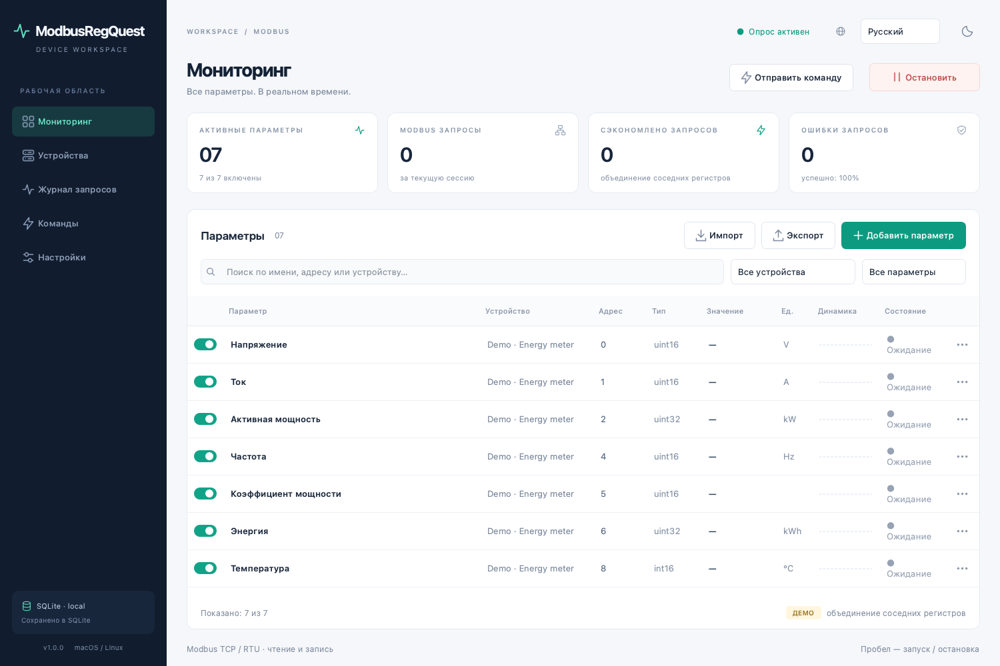
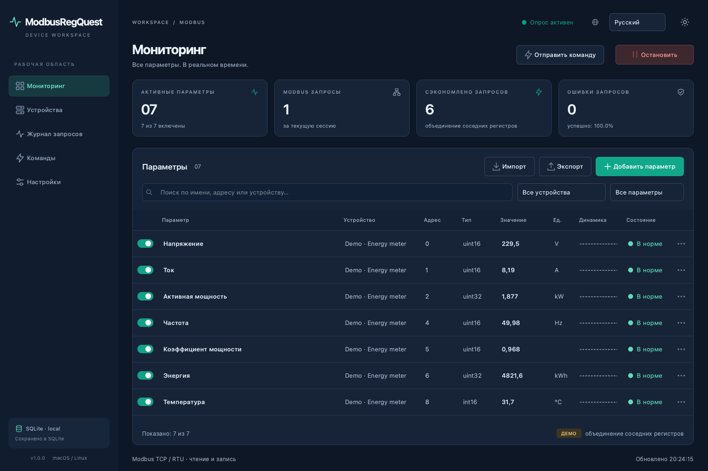
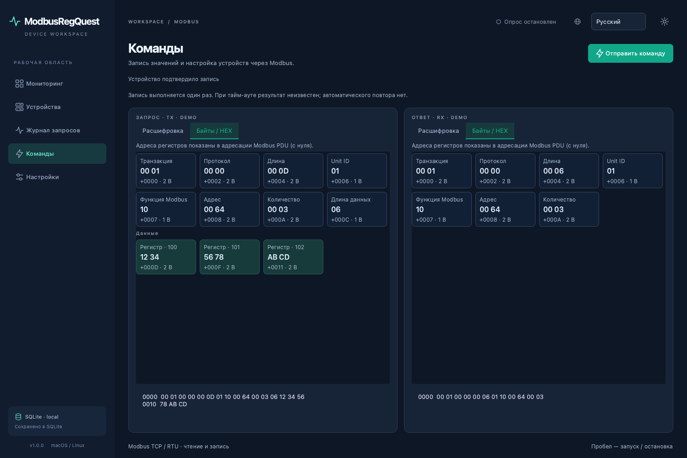
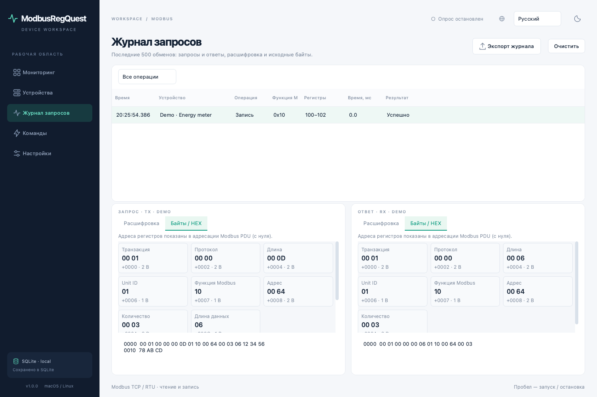

[English](README.md) | **Русский**

<div align="center">


# ModbusRegQuest

**Оконное приложение для опроса, настройки и управления Modbus-устройствами на macOS и Linux.**

Настройте регистры один раз — наблюдайте значения всех параметров в одной таблице.

Modbus TCP / RTU · Чтение и запись · Светлая / тёмная тема · Apache 2.0

</div>

<!-- toc:start -->

## Оглавление

- [Возможности](#возможности)
- [Установка](#установка)
  - [macOS](#macos)
  - [Ubuntu / Debian](#ubuntu--debian)
- [Быстрый старт](#быстрый-старт)
  - [Запись значений и отправка команд](#запись-значений-и-отправка-команд)
  - [Журнал запросов и ответов](#журнал-запросов-и-ответов)
  - [Пример параметров](#пример-параметров)
  - [Адресация: 0 или 1](#адресация-0-или-1)
  - [Масштабирование](#масштабирование)
  - [Типы и порядок байтов](#типы-и-порядок-байтов)
  - [Как объединяются запросы](#как-объединяются-запросы)
  - [Состояния и ошибки](#состояния-и-ошибки)
- [Конфигурация и язык](#конфигурация-и-язык)
- [Запуск из исходников](#запуск-из-исходников)
  - [Локальный TCP-симулятор](#локальный-tcp-симулятор)
- [Сборка установочных пакетов](#сборка-установочных-пакетов)
  - [Выпуск через GitHub Actions](#выпуск-через-github-actions)
  - [Подпись и notarization macOS](#подпись-и-notarization-macos)
- [Проверки](#проверки)
  - [Оглавление README](#оглавление-readme)
- [Решение проблем](#решение-проблем)
- [Структура проекта](#структура-проекта)
- [Обратная связь](#обратная-связь)
- [Лицензия](#лицензия)

<!-- toc:end -->



<details>
<summary>Тёмная тема, команды и журнал обмена</summary>







</details>

## Возможности

- **Одна таблица для всех устройств.** Название, устройство, адрес, тип, актуальное значение, единица измерения, мини-график и состояние параметра. Поиск и фильтры по устройству, активности и ошибкам.
- **Запись и команды.** FC05/06/0F/10 и Mask Write FC16 (коды в HEX): переключение выходов, запись одиночных и нескольких регистров, изменение выбранного бита. Запись значения параметра использует его тип, масштаб и порядок байтов.
- **Modbus TCP и RTU.** Чтение Holding Registers, Input Registers, Coils и Discrete Inputs — функции FC03, FC04, FC01 и FC02. Несколько устройств в одной конфигурации, в том числе несколько Unit ID на одном RTU-порту.
- **Гибкие типы данных.** Целые числа со знаком и без знака на 16/32/64 бит, Float32/Float64 и логические значения. Параметры могут занимать 1, 2 или 4 регистра. Для логического значения в регистре можно выбрать бит 0–15.
- **Масштаб и порядок байтов.** Десятичный сдвиг, перестановка байтов и слов, адресация с нуля или с единицы.
- **Управляемый опрос.** Период для каждого параметра от 0,1 секунды до 24 часов, общий запуск/остановка и отдельные переключатели параметров. Сетевой обмен выполняется в рабочем потоке.
- **Меньше запросов.** Соседние и перекрывающиеся диапазоны объединяются автоматически. Статистика показывает число запросов, ошибок и сэкономленных обращений.
- **Локальное хранение.** Устройства, параметры, язык и тема сохраняются в SQLite после каждого изменения. Импорт и экспорт конфигурации в JSON.
- **Журнал обмена.** Последние 500 пар «запрос — ответ», включая чтение, запись, ошибки и неполные ответы. Расшифровка, исходные байты, подписи полей кадра и адрес каждого двухбайтового регистра. Экспорт журнала в JSON.
- **Светлая и тёмная темы.** Переключение в верхней панели, сохранение выбора и перенос темы вместе с конфигурацией.
- **Деморежим.** Встроенный симулятор позволяет изучить интерфейс без оборудования.

## Установка

Для готовых пакетов Python устанавливать не нужно: приложение включает собственный интерпретатор и Qt.

| Система | Процессор | Файл релиза |
| --- | --- | --- |
| macOS | Apple Silicon · ARM64 | [ModbusRegQuest-1.0-macos-arm64.dmg](https://github.com/apayvin11/modbus-reg-quest/releases/download/v1.0.0/ModbusRegQuest-1.0-macos-arm64.dmg) |
| macOS | Intel · x86_64 | [ModbusRegQuest-1.0-macos-x86_64.dmg](https://github.com/apayvin11/modbus-reg-quest/releases/download/v1.0.0/ModbusRegQuest-1.0-macos-x86_64.dmg) |
| Ubuntu / Debian | Intel / AMD · x86_64 | [modbusregquest_1.0_amd64.deb](https://github.com/apayvin11/modbus-reg-quest/releases/download/v1.0.0/modbusregquest_1.0_amd64.deb) |
| Ubuntu / Debian | ARM64 | [modbusregquest_1.0_arm64.deb](https://github.com/apayvin11/modbus-reg-quest/releases/download/v1.0.0/modbusregquest_1.0_arm64.deb) |

Скачайте подходящий файл из [релиза v1.0.0](https://github.com/apayvin11/modbus-reg-quest/releases/tag/v1.0.0). Контрольные суммы всех четырёх установщиков — [SHA256SUMS](https://github.com/apayvin11/modbus-reg-quest/releases/download/v1.0.0/SHA256SUMS). Пакеты также можно собрать самостоятельно по инструкции ниже.

### macOS

Требуется **macOS 15 Sequoia или новее**.

1. Откройте подходящий `.dmg`.
2. Перетащите **ModbusRegQuest.app** на ярлык **Applications / Программы** внутри образа.
3. Извлеките образ. Запускайте ModbusRegQuest из «Программ», Launchpad или Spotlight. Иконку можно закрепить в Dock.

По умолчанию сборка имеет локальную ad-hoc-подпись, без Apple notarization. При первом запуске скачанного приложения macOS может потребовать разрешить его в **Системные настройки → Конфиденциальность и безопасность**. Сборка с Developer ID и notarization описана в разделе выпуска.

### Ubuntu / Debian

Для пакетов релиза: **Ubuntu 24.04+ или Debian 13+**, графическая среда X11 либо Wayland с XWayland, `glibc ≥ 2.39`.

Откройте `.deb` в системном установщике либо установите его через APT:

```bash
# Intel / AMD
sudo apt install ./modbusregquest_1.0_amd64.deb

# ARM64 — используйте вместо команды выше
sudo apt install ./modbusregquest_1.0_arm64.deb
```

APT установит необходимые системные библиотеки. После установки найдите **ModbusRegQuest** в меню приложений. Можно также выполнить `modbusregquest` в терминале.

Удаление приложения:

```bash
sudo apt remove modbusregquest
```

Пользовательская конфигурация при удалении пакета сохраняется.

## Быстрый старт

1. Откройте **Устройства → Добавить устройство**.
2. Для **TCP** задайте IP-адрес/имя хоста, порт, Unit ID и тайм-аут. Для **RTU** выберите последовательный порт, скорость, чётность и стоп-биты.
3. Выберите режим адресации: с нуля либо с единицы.
4. На странице **Мониторинг** нажмите **Добавить параметр**. Укажите название, устройство, функцию чтения, адрес, тип данных, единицу измерения и период.
5. При необходимости настройте масштаб и порядок байтов. Сохраните параметр.
6. Нажмите **Начать опрос**. В таблице появятся значения, состояния и мини-графики.

Все настройки сохраняются автоматически. При обычном запуске приложения опрос **всегда выключен**. Клавиша **Пробел** запускает и останавливает опрос; **⌘N / Ctrl+N** открывает добавление параметра. Двойной щелчок по строке открывает редактирование.

На пустой рабочей области кнопка **Открыть деморежим** создаёт тестовое устройство и запускает опрос. Демо помечено в интерфейсе; его значения генерируются программой.

### Запись значений и отправка команд

Для записи значения настроенного параметра откройте меню **⋯ → Записать значение**. Введите значение в тех же единицах, что показаны в таблице. Приложение выполнит обратное масштабирование и применит настроенный порядок байтов. Например, для `uint16` с масштабом `n = 1` ввод `23,4` запишет исходное число `234`.

Входные регистры FC04 и дискретные входы FC02 доступны только для чтения. Для `bool` в Holding Register используется Mask Write Register: меняется выбранный бит, остальные биты сохраняются.

Для произвольной записи откройте **Команды → Отправить команду**:

1. Выберите устройство и функцию записи.
2. Введите адрес с учётом настройки адресации 0/1.
3. Введите целые значения через пробел. Допускаются десятичная запись и `0x` для HEX: `123 456` или `0x007B 0x01C8`.
4. Проверьте предварительный PDU, диапазон адресов и данные.
5. Нажмите **Отправить команду**. На странице команд появится подтверждение либо ошибка, а также полный запрос и ответ.

| Функция (HEX) | Операция | Значения |
| --- | --- | --- |
| `05` | Write Single Coil | Одно значение: `0` или `1` |
| `06` | Write Single Register | Одно целое `0…65535` |
| `0F` | Write Multiple Coils | От 1 до 1968 значений `0` / `1` |
| `10` | Write Multiple Registers | От 1 до 123 целых `0…65535` |
| `16` | Mask Write Register | Две 16-битные маски: AND и OR |

Команды выполняются **однократно** и доступны при остановленном опросе. Чтение и запись используют один рабочий поток, поэтому запросы не перемешиваются на RTU-линии. После подтверждённой записи активный опрос обновит значения при ближайшем чтении. Запись не повторяется автоматически: тайм-аут или потеря ответа означают, что результат неизвестен; устройство могло уже выполнить команду.

Команды «Пуск», «Стоп», «Сброс» и настройки устройства передаются записью в регистры, указанные в его документации. Универсального адреса команды для всех Modbus-устройств не существует.

### Журнал запросов и ответов

Откройте **Журнал запросов** и выберите строку. Две панели показывают **Запрос · TX** и **Ответ · RX**. Выбор сохраняется при поступлении новых записей.

- **Расшифровка:** транспорт, Unit ID, функция, адрес, количество, значения регистров/битов, подтверждение записи либо код исключения. Для опрашиваемых параметров также отображаются декодированные значения, типы и единицы.
- **Байты / HEX:** каждая группа байтов подписана. Для TCP выделены транзакция, протокол, длина, Unit ID и PDU. Для RTU — Unit ID, PDU и CRC16. Поле количества байтов данных имеет отдельную подпись «Длина данных».
- Данные регистров группируются **по два байта**, над каждой парой показан **адрес регистра в PDU, с нуля**. Например, ответ на чтение адресов 100–101 покажет `Регистр · 100: 12 34` и `Регистр · 101: 56 78`.
- Внизу доступен обычный HEX-дамп со смещениями для копирования. Для не полностью отправленного кадра отдельно показан подготовленный запрос; число отправленных байтов указано в расшифровке.
- Неполные, ошибочные и CRC-повреждённые ответы сохраняются в полученном виде. Демокадры помечены как симулированные.
- Фильтр отделяет чтение, запись и обмены с ошибками. **Экспорт журнала** сохраняет все текущие записи в JSON с TX/RX, HEX-байтами, временем, адресами и ошибками.

Журнал хранится в памяти, максимум 500 обменов. История не переносится в конфигурации и очищается после завершения приложения.

### Пример параметров

Пусть устройство предоставляет следующие Holding Registers с адресацией от нуля:

| Название | Адрес | Тип | Регистров | Масштаб `n` | Единица | Исходное → результат |
| --- | ---: | --- | ---: | ---: | --- | --- |
| Напряжение | 0 | `uint16` | 1 | 1 | V | `2304 → 230,4` |
| Ток | 1 | `uint16` | 1 | 2 | A | `842 → 8,42` |
| Активная мощность | 2 | `uint32` | 2 | 3 | kW | `1938 → 1,938` |
| Частота | 4 | `uint16` | 1 | 2 | Hz | `5000 → 50` |
| Температура | 8 | `int16` | 1 | 1 | °C | `−125 → −12,5` |

При одинаковом периоде и одновременной готовности к чтению параметры по адресам 0–4 будут прочитаны одним запросом на 5 регистров. Параметр по адресу 8 будет прочитан отдельным запросом.

### Адресация: 0 или 1

Переключатель задаётся **для устройства** и действует на все его параметры.

| Режим | Введённый адрес | Адрес в Modbus-запросе |
| --- | ---: | ---: |
| Смещение выключено | 0 | 0 |
| Смещение включено | 1 | 0 |
| Смещение включено | 101 | 100 |

Введите номер регистра **без префикса области `3xxxx` / `4xxxx`**. Область выбирается функцией чтения. Например, если документация обозначает первый Holding Register как `40001`, обычно выбирают FC03, адрес `1` и адресацию с единицы. Сверяйтесь с картой регистров конкретного устройства.

### Масштабирование

Поле «Знаков после запятой» задаёт степень десяти:

```text
Значение = декодированное число × 10^(−n)

n =  0: 2345 → 2345
n =  1: 2345 → 234,5
n =  2: 2345 → 23,45
n = −1: 2345 → 23450
```

Поддерживается `n` от −9 до 9. Масштаб применяется после декодирования числа. Для `bool` масштаб не используется.

### Типы и порядок байтов

| Тип | Регистров | Описание |
| --- | ---: | --- |
| `uint16` / `int16` | 1 | Беззнаковое / знаковое целое, 16 бит |
| `uint32` / `int32` | 2 | Беззнаковое / знаковое целое, 32 бита |
| `float32` | 2 | IEEE 754, одинарная точность |
| `uint64` / `int64` | 4 | Беззнаковое / знаковое целое, 64 бита |
| `float64` | 4 | IEEE 754, двойная точность |
| `bool` | 1 | Выбранный бит регистра; для FC01/02 — один дискретный адрес |

Для 32-битного значения доступны **ABCD**, **BADC**, **CDAB** и **DCBA**. Для 64-битных значений те же режимы означают: исходный порядок, перестановка байтов в каждом слове, обратный порядок всех 16-битных слов, полный обратный порядок байтов. Выбирайте режим по документации устройства. Значения `NaN` и `Infinity` отмечаются как ошибка декодирования.

### Как объединяются запросы

Планировщик рассматривает включённые параметры, для которых наступило время очередного чтения. Объединение возможно, если они относятся к **одному устройству и одной функции Modbus**, а их диапазоны соседствуют или перекрываются.

- До **125 регистров** на запрос для FC03/04.
- До **2000 дискретных адресов** на запрос для FC01/02.
- Параметр на 2 или 4 регистра не разрывается между запросами.
- Промежутки с ненастроенными адресами не читаются: это помогает избежать обращения к неподдерживаемым регистрам.
- Параметры с разными периодами объединяются, когда одновременно готовы к чтению. Пропущенные при медленном ответе циклы не накапливаются.

Опрос выполняется последовательно в одном рабочем потоке. Очень короткий период не гарантирует такую же частоту обновления: на неё влияют тайм-ауты, скорость последовательной линии и количество запросов.

### Состояния и ошибки

**В норме** означает успешное недавнее чтение. **Ожидание** — значение ещё не получено; **Пауза** — опрос остановлен; **Выключен** — параметр исключён из опроса. **Устарело** появляется при длительном отсутствии обновления.

При ошибке обмена последнее успешное значение остаётся видимым, но строка получает состояние **Ошибка**; текст ошибки доступен во всплывающей подсказке и журнале. После восстановления соединения приложение продолжает опрос автоматически. Счётчики относятся к текущей сессии опроса; мини-графики хранят последние 60 успешных значений в памяти.

## Конфигурация и язык

Язык выбирается в правом верхнем углу. Кнопка с иконкой солнца или луны переключает оформление. Язык и тема сохраняются в SQLite и входят в экспорт JSON.

SQLite хранится в пользовательском каталоге приложения. Точный путь показан в **Настройки → Локальная база данных**. Обычно это:

- macOS: `~/Library/Application Support/ModbusRegQuest/ModbusRegQuest/configuration.db`;
- Linux: `~/.local/share/ModbusRegQuest/ModbusRegQuest/configuration.db`.

Для переноса используйте **Экспорт** и **Импорт**. JSON содержит устройства, параметры, идентификаторы, язык и тему, имеет формат `modbusregquest`, версию схемы `1` и остаётся читаемым человеком. Импорт проверяет типы, диапазоны, связи и уникальность идентификаторов; максимальный размер файла — 5 MiB. После подтверждения текущая конфигурация заменяется целиком. Для возврата к старой конфигурации предварительно экспортируйте её.

Запись конфигурации выполняется транзакцией SQLite; экспорт — через временный файл с атомарной заменой. Журнал обмена и история значений в БД не записываются.

При первом запуске под новым названием ранее существовавшая база ModbusPoll копируется в новый пользовательский каталог. Исходная база сохраняется. Старые JSON-конфигурации с форматом `modbuspoll` также поддерживаются; при экспорте используется `modbusregquest`.

## Запуск из исходников

Требуется **Python 3.10+**. Для сборок релиза рекомендуется Python **3.12**.

```bash
python3 -m venv .venv
.venv/bin/python -m pip install -r requirements.txt
.venv/bin/python -m modbusregquest
```

Либо выполните `./run.sh`: при отсутствии `.venv` скрипт создаст окружение и установит зависимости.

Для Ubuntu/Debian установите библиотеки графического окружения:

```bash
sudo apt update
sudo apt install python3-venv libgl1 libegl1 libopengl0 \
  libxcb-cursor0 libxkbcommon-x11-0 libxcb-icccm4 \
  libxcb-keysyms1 libxcb-xinerama0 libxcb-render-util0
```

Полезные параметры запуска:

```bash
# Изолированная демонстрация: не заменяет основную конфигурацию
./run.sh --demo

# Английский интерфейс и тёмная тема
./run.sh --language en --theme dark

# Отдельная база конфигурации
./run.sh --db /path/to/configuration.db

# Снимок окна и автоматическое завершение для проверки
QT_QPA_PLATFORM=offscreen ./run.sh --demo \
  --screenshot /tmp/modbusregquest.png --quit-after 3
```

Параметры запуска также доступны у собранного бинарника. В macOS бинарник находится внутри `ModbusRegQuest.app/Contents/MacOS/ModbusRegQuest`; в Linux после установки доступна команда `modbusregquest`.

### Локальный TCP-симулятор

Для проверки настоящего TCP-обмена без внешнего оборудования:

```bash
python3 scripts/modbus_simulator.py --port 1502
```

В приложении добавьте TCP-устройство `127.0.0.1:1502`, Unit ID `1`, адресацию от нуля. Используйте параметры из таблицы примера. Симулятор поддерживает FC01–04; регистры 0–8 содержат тестовые значения.

## Сборка установочных пакетов

Сборка выполняется **нативно на целевой ОС и архитектуре**. Скрипт проверяет архитектуру запущенного Python и не позволит выдать ARM64-пакет за x86_64 или наоборот. В релиз включаются Python, Qt, pyserial и иконки; установка Python на компьютере пользователя не требуется.

Подготовьте чистое окружение:

```bash
python3 -m venv .venv
.venv/bin/python -m pip install -r requirements-release.txt
```

`requirements-release.txt` фиксирует версии основных компонентов релиза. Выберите команду на соответствующей машине:

| Целевая платформа | Команда |
| --- | --- |
| macOS Apple Silicon | `.venv/bin/python scripts/package.py --format dmg --arch arm64` |
| macOS Intel | `.venv/bin/python scripts/package.py --format dmg --arch x86_64` |
| Ubuntu AMD64 | `.venv/bin/python scripts/package.py --format deb --arch x86_64` |
| Ubuntu ARM64 | `.venv/bin/python scripts/package.py --format deb --arch arm64` |

На macOS используются системные `iconutil`, `codesign`, `ditto` и `hdiutil`; для `notarytool` понадобятся Xcode Command Line Tools. На Ubuntu/Debian нужен `dpkg-deb` из пакета `dpkg`.

Готовые установщики и контрольные суммы появляются в `release/`:

```text
release/
├── ModbusRegQuest-1.0-macos-arm64.dmg
├── ModbusRegQuest-1.0-macos-arm64.dmg.sha256
├── ModbusRegQuest-1.0-macos-x86_64.dmg
├── ModbusRegQuest-1.0-macos-x86_64.dmg.sha256
├── modbusregquest_1.0_amd64.deb
├── modbusregquest_1.0_amd64.deb.sha256
├── modbusregquest_1.0_arm64.deb
└── modbusregquest_1.0_arm64.deb.sha256
```

Каждая команда создаёт только пакет своей архитектуры. Каталог выше показывает полный набор после четырёх сборок. `--format bundle` создаёт только `dist/ModbusRegQuest.app` на macOS или `dist/ModbusRegQuest/` на Linux. `--skip-bundle` упаковывает уже существующий результат сборки.

DMG содержит приложение с иконкой и ссылку на «Программы». DEB устанавливает приложение в `/usr/lib/modbusregquest`, команду `/usr/bin/modbusregquest`, файл меню `/usr/share/applications/modbusregquest.desktop` и набор иконок в `hicolor`.

### Выпуск через GitHub Actions

Workflow [Build installers](.github/workflows/release.yml) запускается вручную через **Actions → Build installers → Run workflow** либо при отправке тега `v1.0` / `v1.0.0`.

Матрица использует четыре нативные среды: `macos-15`, `macos-15-intel`, `ubuntu-24.04` и `ubuntu-24.04-arm`. Каждый job запускает тесты, собирает свой установщик и проверяет запуск собранного приложения. Для Linux дополнительно проверяются установка и удаление DEB и файл меню.

После успешной сборки:

1. Скачайте четыре артефакта со страницы запуска workflow.
2. Распакуйте ZIP-контейнеры GitHub Actions.
3. Приложите `.dmg`, `.deb` и при необходимости `.sha256` к релизу репозитория.

Workflow **не публикует релиз автоматически**. Файлы готовы для ручного прикрепления.

### Подпись и notarization macOS

Для релиза с Apple Developer ID выполните сборку на Mac, где сертификат уже установлен в Keychain:

```bash
export MACOS_CODESIGN_IDENTITY='Developer ID Application: Your Name (TEAMID)'
export MACOS_NOTARY_PROFILE='your-notarytool-keychain-profile'
.venv/bin/python scripts/package.py --format dmg --arch arm64
```

Для Intel используйте нативный Intel Python и `--arch x86_64`. Скрипт подписывает приложение, отправляет DMG на notarization, прикрепляет результат и проверяет образ. Без этих переменных создаётся ad-hoc-подписанное приложение без notarization. Сертификаты и учётные данные Apple в репозиторий не добавляются.

## Проверки

```bash
.venv/bin/python -m unittest discover -s tests -v
```

Тесты проверяют запись и чтение по TCP/RTU, подтверждения команд, отсутствие повторов записи, сохранение неполных ответов, подписи байтов и адресов регистров, светлую/тёмную темы, перенос старой БД, декодирование и перестановку байтов, масштабы, границы адресов, объединение запросов и ограничения протокола, SQLite и JSON, обмен с TCP-сервером, RTU через POSIX-псевдотерминал, работу интерфейса, переключение языка, запуск/остановку и восстановление соединения.

Интерфейсные тесты используют Qt offscreen. Для проверки настоящего X11 backend на Linux:

```bash
sudo apt install xvfb
QT_QPA_PLATFORM=xcb xvfb-run -a .venv/bin/python -m modbusregquest \
  --demo --screenshot /tmp/modbusregquest-linux.png --quit-after 3
```

Проверено на **macOS ARM64**, **macOS x86_64 через Rosetta 2**, **Ubuntu 24.04 ARM64** и **Ubuntu 24.04 amd64 через QEMU**. Для amd64 также проверены установка в чистой Ubuntu без Python, запуск обеих тем и удаление пакета. Реальное внешнее Modbus-оборудование для автоматических проверок не использовалось.

### Оглавление README

Оглавление строится автоматически из заголовков Markdown `##`–`######` в обоих файлах: `README.md` и `README.ru.md`. GitHub Actions обновляет оба файла и сохраняет изменения отдельным коммитом после изменений README или генератора в основной ветке; в pull request проверяет актуальность обоих оглавлений. Workflow также можно запустить вручную через **Actions → README table of contents → Run workflow**.

Для локального обновления достаточно Python 3.10+, зависимости приложения устанавливать не нужно:

```bash
python3 scripts/update_readme_toc.py
python3 scripts/update_readme_toc.py --check
```

Редактируйте заголовки разделов; блок между комментариями `toc:start` и `toc:end` обновляется генератором с сохранением языка его заголовка. Чтобы обработать только одну версию, передайте путь к ней, например `python3 scripts/update_readme_toc.py README.ru.md`.

## Решение проблем

| Симптом | Что проверить |
| --- | --- |
| Нет ответа по TCP | IP/имя хоста, порт, Unit ID, сетевую доступность, firewall и тайм-аут. Обычно Modbus TCP использует порт 502. |
| Нет ответа по RTU | Последовательный порт, права доступа, скорость, чётность, стоп-биты, адрес устройства и подключение RS-485. |
| `Permission denied` для последовательного порта | В Ubuntu/Debian доступ обычно даёт группа `dialout`: `sudo usermod -aG dialout "$USER"`, затем выйдите из сеанса и войдите снова. |
| `Illegal data address` / исключение `0x02` | Функцию FC03/04, карту регистров, смещение 0/1 и размер многорегистрового параметра. |
| Число выглядит неправдоподобно | Тип, знак, порядок байтов/слов и десятичный масштаб. |
| `Could not load the Qt platform plugin "xcb"` | Системные зависимости Qt. Для готового пакета используйте `apt install ./…deb`, чтобы установить зависимости автоматически. |
| Обновления реже заданного периода | Тайм-ауты и ошибки в журнале, количество запросов и скорость RTU. |

Modbus ASCII, TLS, произвольные пользовательские функции протокола, долговременное хранение измерений и облачная синхронизация в версии 1.0 не реализованы.

## Структура проекта

```text
modbusregquest/
  app.py          запуск и аргументы командной строки
  window.py       основное окно и рабочие страницы
  dialogs.py      редакторы устройств и параметров
  models.py       конфигурация и её проверка
  protocol.py     TCP/RTU, CRC, декодирование, план запросов
  poller.py       фоновый опрос, очередь команд и расписание
  commands.py     проверка и кодирование команд записи
  tracing.py      разбор кадров, подписи полей и HEX
  simulation.py   модель устройства для демо и тестов
  storage.py      SQLite, импорт и экспорт
  i18n.py         русский и английский интерфейс
  theme.py        оформление и интерфейсные иконки
  widgets.py      переключатели, мини-графики и просмотр байтов
assets/           иконка и снимки интерфейса
packaging/        Linux desktop entry
scripts/          сборка пакетов, иконки и TCP-симулятор
tests/            модульные, интеграционные и интерфейсные проверки
.github/workflows/release.yml
```

Сведения о сторонних компонентах и их лицензиях: [THIRD_PARTY_NOTICES.md](THIRD_PARTY_NOTICES.md).

## Обратная связь

Сообщения об ошибках, предложения и вопросы: [GitHub Issues](https://github.com/apayvin11/modbus-reg-quest/issues).

## Лицензия

**Apache License 2.0 (Apache-2.0)**. Полный текст — [LICENSE](LICENSE), сведения об авторстве — [NOTICE](NOTICE).

Исходный код проекта распространяется на условиях Apache License 2.0. Лицензии сторонних библиотек сохраняются и приведены в [THIRD_PARTY_NOTICES.md](THIRD_PARTY_NOTICES.md). Файлы LICENSE и NOTICE включаются в устанавливаемые пакеты.
